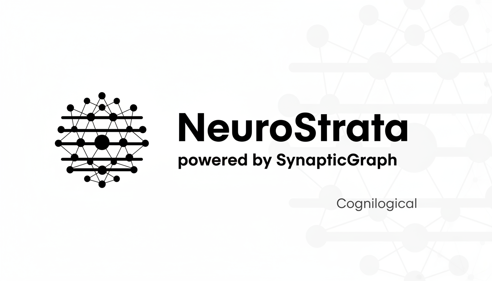

# 🧠 NeuroStrata



### **Stop Being the Copy-Paste Memory Between Your AI Coding Sessions.**

Every time you start a new chat, switch worktrees, or spawn a subagent, your AI forgets your architecture. It repeats last week's bug, ignores rules buried in `AGENTS.md`, greps blindly through thousands of files, and claims a task is "done" while leaving broken callers and `TODO` stubs behind.

**NeuroStrata fixes that permanently.**

Packed into **one compiled Rust binary** with an embedded vector, graph, and W3C RDF/SPARQL engine, NeuroStrata gives your coding agent an **enforceable long-term memory, a live software knowledge graph, and mechanical quality gates** that the agent cannot talk its way past—and **your agent sets it up and upgrades it automatically with zero manual configuration.**

👉 **[Explore the Complete Feature & Benefit Catalog (`docs/FEATURES.md`)](docs/FEATURES.md)**

---

## Why Use NeuroStrata? (The Benefits)

### 1. Zero-Touch Setup & Upgrades — *Your Agent Does It All*
You never hand-write config files, wire hooks, or run database migrations.
- **Say *"Initialize NeuroStrata"* and walk away:** On init, NeuroStrata automatically detects which CLI/terminal harness your agent is running in (**OpenCode**, **Claude Code**, **Hermes Agent**, **OpenAI Codex CLI**, **GitHub Copilot CLI**, or **OpenClaw**), extracts and wires the matching zero-dependency plugin, installs git hooks, scans your repo, and ingests your codebase AST.
- **Drop-in self-upgrading binary:** When you update `neurostrata-mcp`, the very next session snapshot automatically detects the version delta, upgrades stale git hooks and harness plugins in place, backfills new schema defaults, and instructs the agent to wire any new lifecycle capabilities.

### 2. Teach Once, Enforce Forever (No More Ignored Prompts)
System prompts get compacted and ignored. Binary gates do not.
- **Zero-Action Start:** Your agent is mechanically blocked from editing files or running mutating commands until it has loaded the project snapshot and claimed a tracked task.
- **Closing Work Requires Teaching (Lock 2 Done-Funnel):** A task *cannot* transition to `done` unless the agent extracts at least one architectural rule, fix, or lesson into permanent memory. Every completed task makes your repository smarter.
- **Unfinished Work Cannot Be Pushed (Lock 1 Pre-Push Gate):** `git push` is automatically gated—if any task is left `in_progress`, lacks an extracted memory, or leaves untracked `TODO`/`FIXME` debt in diffs, the push is blocked before it leaves your machine.

### 3. Subagents Never Spawn With a Blank Brain Again
When your primary agent delegates work to a subagent, context usually evaporates.
- **Automatic Context Injection:** Creating or claiming a task automatically runs a hybrid vector + 1-hop graph search and builds a ready-to-inject `subagent_prompt_injection` block containing the governing architectural rules and AST call-chain neighbors.
- **Harness-Level Interception:** All 6 NeuroStrata harness plugins automatically prepend that context block into every spawned subagent (`subagent`, `Task`, `delegate_task`, `spawn_agent`).

### 4. Instant Blast-Radius & Architectural Awareness Before Every Edit
Instead of burning tokens on blind `grep` loops and breaking downstream callers:
- **Unified Code + Memory Graph:** Tree-sitter parses **11 languages** (Rust, TypeScript/TSX, Python, Go, C#, Java, C/C++, HTML, CSS, Bash, Markdown) into the same graph as your architectural rules.
- **Know What Breaks First:** One tool call (`neurostrata_memories_for_file`, `neurostrata_impact_analysis`, `neurostrata_trace_call_chain`, or `neurostrata_sparql_query`) tells the agent every rule governing a file and every upstream/downstream caller affected by a change.
- **Negative Exemplars:** Failed approaches are recorded as first-class evidence (`outcome: "failed"`), so future sessions never waste hours repeating a dead end.

### 5. Pre-Execution Safety Conscience (Podman Sandbox)
- **Semantic Guard Rules:** Proposed shell commands and file mutations are semantically matched against your project's `guard_rule` memories before execution.
- **Isolated Dry-Run:** Borderline commands are dry-run inside an ephemeral, rootless `podman --network=none --read-only` container before a single byte touches your real disk.

### 6. 100% Local Sovereignty + Brokerless Git Team Sync
- **Zero Cloud Lock-In, Zero Docker:** Embedded **LadybugDB** (vector + property graph), **Tantivy** (BM25 full-text), **FlashRank ONNX** (neural cross-encoder reranking), **OxiRS** (W3C RDF / SPARQL 1.1 / OWL 2 RL / SHACL), **Laya** (local duplicate judgment), and **fastembed** all run inside a single native binary on `127.0.0.1:34343`.
- **Team Memory Over Plain Git (`SynapticMesh`):** Share approved rules and procedures across your team via standard `git push` and `git pull --ff-only`. Private memories stay on your disk, and team conflicts are preserved visibly—no SaaS account or message broker needed.

---

## How Easy Is Setup & Upgrading?

### First-Time Install (Once Per Machine)
```bash
# 1. Build and install the single Rust binary (includes embedded LadybugDB + OxiRS + ONNX)
scripts/build.sh

# 2. Register and start the local loopback daemon (127.0.0.1:34343)
neurostrata-mcp setup
```

### Initialize Any Repository (Zero User Involvement)
Open your AI coding agent in any repository and say:
> **"Initialize NeuroStrata for this project."**

**Your agent does the rest automatically:**
1. Calls `neurostrata_bootstrap` (new repo) or `neurostrata_task_setup` (existing repo).
2. Auto-detects your active harness (**OpenCode**, **Claude Code**, **Hermes**, **Codex CLI**, **GitHub Copilot CLI**, or **OpenClaw**) and installs/wires the embedded zero-dependency plugin under `.NeuroStrata/plugins/<harness>/`.
3. Installs and activates the `pre-commit` (secret scan + incremental AST re-ingest) and `pre-push` (strict task gate + SynapticMesh sync) git hooks.
4. Ingests your codebase AST and seeds your initial architectural rules.

### Upgrading (Zero Manual Migration)
When a new version of NeuroStrata ships, update the binary (`scripts/build.sh` or replace `~/.cargo/bin/neurostrata-mcp`) and keep working. On the very next session start (`neurostrata_get_snapshot`), NeuroStrata **automatically upgrades your git hooks, refreshes your embedded harness plugins, backfills database schemas, and wires any new lifecycle features.**

---

## Feature Overview at a Glance

> For the complete 12-part breakdown of every subsystem, tool, and code reference, see **[`docs/FEATURES.md`](docs/FEATURES.md)**.

| Subsystem | What It Delivers | Deep-Dive Docs |
| :--- | :--- | :--- |
| **Zero-Touch Harness Auto-Installer** | Auto-detects and wires plugins for **OpenCode, Claude Code, Hermes, Codex CLI, GitHub Copilot CLI, and OpenClaw** on init and snapshot. | [Features §1–2](docs/FEATURES.md#1-zero-touch-onboarding--self-upgrading-lifecycle) |
| **Graph-First & Subagent Injection** | Auto-retrieves vector + 1-hop graph context on task claim and injects governing rules into every subagent prompt. | [Features §3](docs/FEATURES.md#3-automatic-graph-first-exploration--subagent-context-propagation) |
| **Central Executive (Tasks & Locks)** | 4-state task lifecycle, Zero-Action Start, Lock 2 Done-Funnel (mandatory extraction), Lock 1 Pre-Push Gate, and lexical `TODO` intent detection. | [Central Executive](docs/organs/central-executive.md) |
| **Memory Core (SynapticGraph)** | Embedded LadybugDB vector + graph store, Tantivy BM25 + HNSW + RRF + PPR + FlashRank ONNX 4-stage retrieval, negative exemplars, and Leiden communities. | [SynapticGraph](docs/architecture/synapticgraph.md) · [Tri-Strata](docs/architecture/tri-strata.md) |
| **Multi-Language AST & Impact Graph** | Incremental Tree-sitter AST ingestion for 11 languages, upstream/downstream call-chain tracing, blast-radius analysis, and GLiNER entity extraction. | [Features §6](docs/FEATURES.md#6-multi-language-tree-sitter-ast-software-graph--blast-radius-analysis) |
| **W3C Semantic Graph (OxiRS)** | Native RDF quad projection, **SPARQL 1.1** queries (`SELECT`/`ASK`/`CONSTRUCT`), **OWL 2 RL** inference, and closed-world **SHACL** validation. | [Features §7](docs/FEATURES.md#7-w3c-semantic-knowledge-graph--rdf-sparql-11-owl-2-rl--shacl) |
| **Prefrontal Cortex (Safety Guard)** | Semantic rule matching against `guard_rule` memories + rootless `podman --network=none` dry-run sandbox before disk mutation. | [Prefrontal Cortex](docs/organs/prefrontal-cortex.md) |
| **Digital Twins & Telemetry** | Versioned state modeling, structural diffs, rollbacks, policy simulations (`neurostrata_twin_*`), and rolling time-series metrics (`neurostrata_metrics_*`). | [Features §9](docs/FEATURES.md#9-digital-twins-state-simulation--neuroplasticity-telemetry) |
| **Procedural Memory & Laya Judge** | Triggered habits with finite rehearsal budgets (`neurostrata_procedure_perform`) + local trainable **Laya** duplicate/contradiction judgment. | [Procedural Memory](docs/organs/procedural-memory.md) · [Judgment](docs/architecture/domains/judgment-providers.md) |
| **SynapticMesh (Git Team Sync)** | Brokerless team memory sharing over standard `git push` / `git pull --ff-only` with sovereign private rows and visible conflict resolution. | [SynapticMesh](docs/mesh/synaptic-mesh.md) |
| **Thalamic Bus, Obsidian & Security** | In-process pub/sub bus, rolling 500 KB episodic session logs, bidirectional Obsidian vault sync, secret scrubbing, and loopback-only security. | [Thalamic Bus](docs/organs/thalamic-bus.md) · [Security](docs/ops/security.md) · [Obsidian](docs/ops/obsidian.md) |

---

## Technical Documentation & Architecture Links

- **Product & Feature Inventory:** [Complete Feature & Benefit Catalog (`docs/FEATURES.md`)](docs/FEATURES.md)
- **Architecture & Cognitive Science:** [Cognitive Architecture](docs/COGNITIVE_ARCHITECTURE.md) · [SynapticGraph Engine](docs/architecture/synapticgraph.md) · [Tri-Strata Isolation](docs/architecture/tri-strata.md) · [Why Agent Memory Fails](docs/science/why-memory-fails.md) · [Nomenclature](docs/science/nomenclature.md)
- **Cognitive Organs:** [Central Executive](docs/organs/central-executive.md) · [Prefrontal Cortex](docs/organs/prefrontal-cortex.md) · [Dendritic Bridge (Embedders)](docs/organs/dendritic-bridge.md) · [Thalamic Bus](docs/organs/thalamic-bus.md) · [Procedural Memory](docs/organs/procedural-memory.md)
- **Operations & Reference:** [Zero-Touch Upgrading](docs/ops/upgrading.md) · [CLI Reference](docs/ops/cli-reference.md) · [Security & OWASP Mitigations](docs/ops/security.md) · [SynapticMesh Team Sync](docs/mesh/synaptic-mesh.md) · [Obsidian Sync](docs/ops/obsidian.md) · [Crash & WAL Recovery](docs/ops/crashes.md) · [Building from Source](docs/BUILDING.md) · [Release Changelogs](docs/releases/changelog/)

## License

MIT — [`LICENSE`](LICENSE).