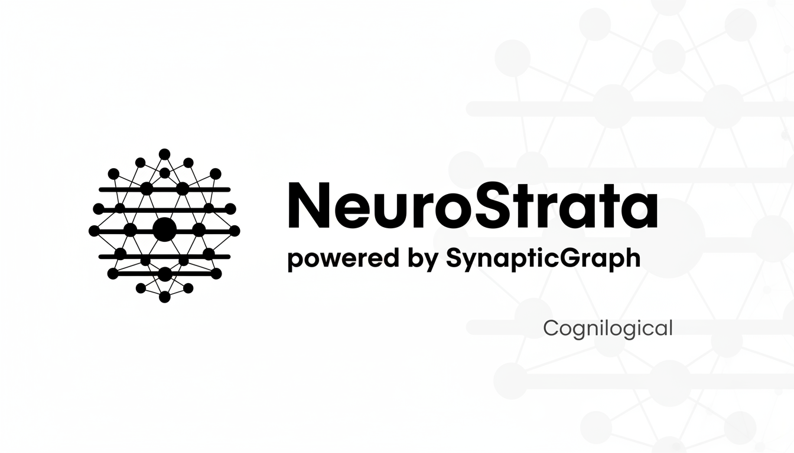

# 🧠 NeuroStrata



**Your agent forgets. You become its memory. NeuroStrata ends that arrangement.**

Open a new chat or switch worktrees and the agent repeats last week's mistake. You re-explain. It forgets again. Eventually you stop explaining and just fix things yourself, because teaching a goldfish is slower than doing the work.

The model isn't the problem. Nothing in the stack *forces* memory to happen before work closes. Prompts get ignored. Context windows compact. System messages scroll away. The only thing that survives is a mechanical gate the agent cannot talk its way past.

NeuroStrata is that gate.

## What it is

One compiled Rust binary carrying an embedded graph-and-vector store (LadybugDB, in-process). It gives an AI coding agent a permanent, enforceable memory across every project and every chat: rules you teach once are semantically enforced against future actions, work cannot close without producing a recorded lesson, and teammates share context over plain git. It runs on your machine by default; remote services are opt-in and explicit.

## Three things no other memory system does

**Closing work requires teaching.** A goal moves through `open → in_progress → blocked → done`, but `done` has exactly one guarded entrance. The binary refuses the transition unless the goal produced a recorded lesson — a graph edge linking the work to a stored memory. That check lives in the binary itself, so it fires whether or not you use git. If you do use git, a pre-push hook adds a second gate that blocks `git push` while unfinished or unconsolidated goals remain. A reminder in a prompt cannot enforce that. The binary does.
**Rules are a namespace, not a config file.** Operational rules live as ordinary memory records in the same embedded database as everything else. A tool surfaces `guard_validate`: a proposed action is embedded and semantically matched against those rules before execution. Close matches are rejected outright. Borderline cases are dry-run inside an isolated `podman --network=none` container before any byte reaches disk. You teach once. Enforcement applies across every session, agent, and worktree — but only for callers that route through the tool; an agent that never calls it gets nothing, and the `zero-action-start` wire is advisory, not a hard block.

**Team memory travels over git.** Sharing constraints across machines or teammates needs no hosted API or message broker. Approved memories write to a durable local log, serialize into deterministic wire records, and push through standard `git push`. Incoming records pass strict schema, namespace, and lifecycle validation. Conflicts are preserved loudly, never silently resolved. Private rows stay on your disk. Your team shares context the same way it shares code.

## The organs, in plain English

- **Memory Core (SynapticGraph + Engrams)** — memory is stored as `{file, lines}` pointers, not pages, so reasoning stays intact instead of drowning in dumped docs. Retrieval combines vector distance with bounded graph expansion; no BM25, no RRF. A boot-time top-5 snapshot grounds each session instantly. Access counts only reinforce rows; nothing you built is quietly dropped while live. Failed approaches are kept as negative exemplars, so a dead end is evidence, not amnesia.
- **Tri-Strata + Domain Registry** — Global / Domain / Task namespaces keep company rules out of a bug fix. Every domain write is checked against registered slugs; unknown writes are refused with the remedy.
- **Prefrontal Cortex (Behavioral Guard)** — rules stored as `guard_rule` records; a tool surface (`guard_validate`) returns a verdict (`DeterministicReject` or `SandboxReject`) for an action routed through it, with an optional network-isolated container dry-run. `rm -rf /` never reaches disk. Coverage is voluntary-caller scoped; agents that never call the tool are not guarded.
- **Central Executive (Goals)** — the four-state lifecycle with the done-funnel. Zero-Action Start: no edits before a goal exists and is claimed by this session; duplicate work fails loudly at claim time. A SAS pre-push gate keeps unfinished goals on your machine. Retired rows are distinguished from live work.
- **Dendritic Bridge (Embedders)** — one file (`embedders.json`) decides between a local fastembed model and a remote OpenAI-compatible endpoint. Missing keys fail closed with a clear error, never a silent width swap.
- **Thalamic Bus** — typed in-process pulses (Created / Superseded / Archived / GuardedActionFired) so bookkeeping happens because a write happened, not because an agent remembered. An export-freshness gate refuses stale graph exports and names every dirty namespace at once.
- **Procedural Memory** — `memory_type: "procedure"` with a finite rehearsal budget; knowing-how strengthens or lapses explicitly, with no state lost mid-session.
- **SynapticMesh** — team sync over plain git (durable WAL → wire records → validated pull → lifecycle merge → conflicts preserved). No broker, no SaaS.
- **Episodic Buffer** — background session log with topic-switch markers and 500 KB rollover; context is recovered by grep, not archaeology.
- **Source-Anchor Registry** — multi-checkout provenance so the same memory stays correct across worktrees.

## You choose what leaves your machine

The default is fully local: an embedded graph-and-vector database plus in-process embeddings. No separate database server. No broker. No SaaS account. No cloud inference. Initial model setup may download weights; embedding your memory never sends it to a provider.

Want different infrastructure? Declare an embedding bridge in `embedders.json` — OpenAI, Ollama, Llama.cpp, or any OpenAI-compatible endpoint. Those can run on your machine, on your network, or remotely. A declared bridge with a missing key fails closed with an explicit error; there is no silent fallback to an incompatible embedding space. Team sharing over git is optional. You decide which processing and sharing paths cross your trust boundary.

## How Laya and Jev make this structurally different

LadybugDB is the embedded engine. All vectors, graph edges, and source pointers live inside it. Two optional judgment layers sit on top, but neither replaces the database:

- **Laya** is the local ONNX judgment interface. Its duplicate-judgment path currently returns empty results. That is not a bug — it is proof that embedded retrieval operates independently and never blocks on local model weights. The system works fully offline with zero judgment-layer output.
- **Jev** provides optional remote duplicate judgments via `typesafe.ai`. These are judgments, not embeddings. They do not change the vector space and need no cloud account for core operation. Declaring a bridge changes which judgments feed ranking; it never moves the database.

Neither Laya nor Jev takes ownership of your data. The database stays local, sovereign, and intact regardless of which judgment layers are configured.

## Why it is worth your time

If you maintain architecture across worktrees and run agents that must not forget rules, this is the only system where forgetting is a structural failure, not a runtime surprise. One binary. One embedded store. One pre-push hook that keeps unfinished goals on your machine until they have taught something. No cloud account. No Docker. No separate database process. No prompt tricks.

Stop acting as the continuity layer between agent sessions.

## Get started

```bash
# Build (Rust + CMake + C++20 for the vendored LadybugDB engine)
scripts/build.sh

# Wire the guard and task gate into this repo (hooks install is git-only;
# the done-funnel and guard still enforce without git)
neurostrata-mcp hooks install
neurostrata_bootstrap          # new project
# neurostrata_task_setup        # existing project
```

The daemon listens on loopback only (`127.0.0.1:34343`) and serves `/validate`, `/tasks/gate`, `/graph`, `/mcp`, `/bus/metrics`, `/backup`, `/shutdown` — all inside the machine.

## Deep documentation

[Features](docs/FEATURES.md) · [Architecture](docs/COGNITIVE_ARCHITECTURE.md) · [Security](docs/ops/security.md) · [SynapticMesh](docs/mesh/synaptic-mesh.md) · [Changelog](docs/releases/changelog/) · [CLI Reference](docs/ops/cli-reference.md) · [Nomenclature](docs/science/nomenclature.md) · [Why memory fails](docs/science/why-memory-fails.md)

## Source references

- `src/task/machine.rs` — four-state lifecycle, eight legal edges, `done` guarded by `ExtractionRequired`.
- `src/task/gate.rs` — SAS pre-push gate: in-progress tasks, done-without-extraction, P0 open > 24 h.
- `src/guard/semantic.rs`, `src/guard/sandbox.rs` — `guard_rule` namespace, semantic match, podman `--network=none` dry-run, verdict vocabulary.
- `src/embed.rs` — local fastembed plus fail-closed remote bridge resolution via `embedders.json`.
- `src/judgment/laya_onnx.rs`, `src/judgment/typesafe_jev.rs` — local Laya stub (empty output) and optional remote Jev duplicate judgments.
- `src/synaptic_mesh/` — git transport, `synaptic-mesh-record/v1` wire format, ff-only pull, conflict preservation.
- `src/daemon.rs` — loopback-only daemon (`127.0.0.1:34343`).
- `src/secrets.rs`, `src/store/ladybug.rs` — secret scrubbing and Cypher escaping.
- `src/server.rs` — MCP tool surface (additive only; no destructive memory tools).

## License

MIT — [`LICENSE`](LICENSE).
